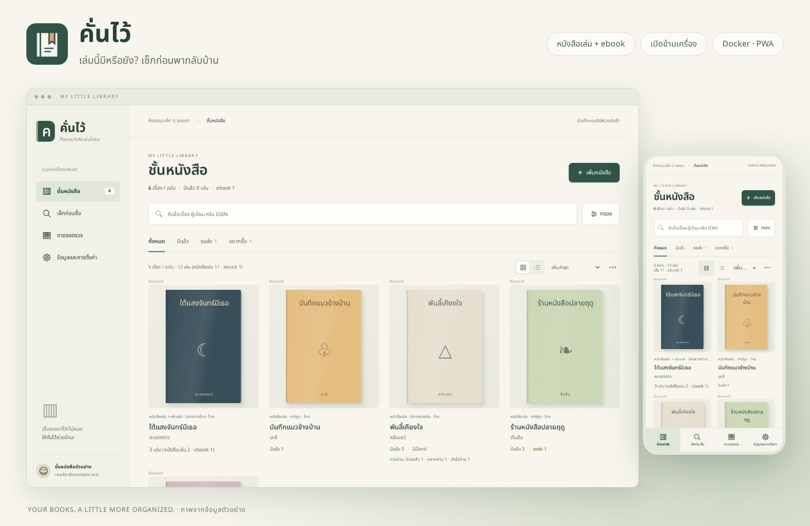
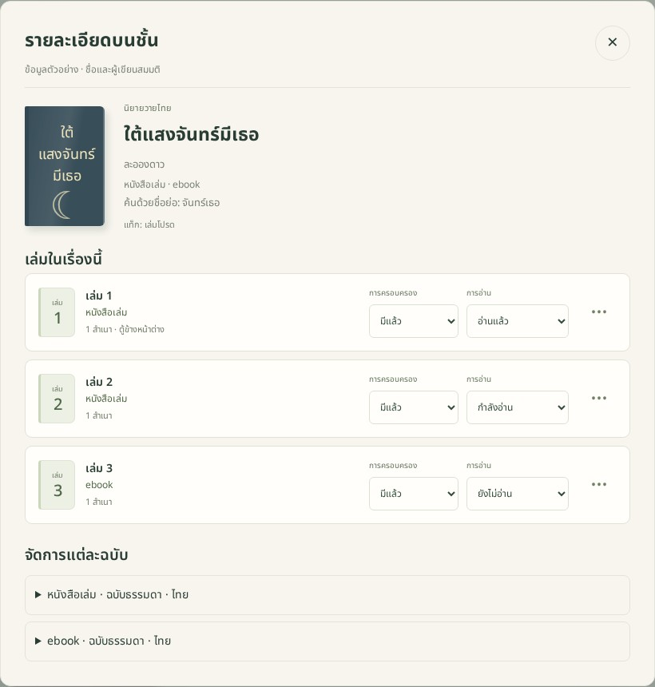

<h1 align="center">คั่นไว้</h1>

<p align="center"><strong>เล่มนี้มีหรือยัง?</strong> เปิดชั้นหนังสือของเธอแล้วเช็กได้เลย</p>

<p align="center">
  <a href="#เริ่มใช้ด้วย-docker"><strong>เริ่มใช้ด้วย Docker</strong></a> ·
  <a href="#ภาพหน้าจอ">ดูภาพหน้าจอ</a> ·
  <a href="docs/architecture.md">โครงสร้างระบบ</a> ·
  <a href="docs/README.md">คู่มือทั้งหมด</a>
</p>



**คั่นไว้** เป็นชั้นหนังสือส่วนตัวสำหรับการ์ตูน นิยาย และ ebook เปิดเช็กจากมือถือที่ร้านหนังสือ แล้วกลับมาจัดชั้นต่อบนคอมด้วยบัญชีเดียวกัน ข้อมูลเก็บบนเซิร์ฟเวอร์ที่เธอติดตั้งเอง

## ภาพหน้าจอ

### หนังสือเล่มกับ ebook อยู่ในเรื่องเดียวกัน

เชื่อมฉบับแล้วเปิดดูทุกเล่มในหน้าเดียว แต่ละแถวบอกว่าเป็นหนังสือเล่มหรือ ebook และแก้สถานะการครอบครองกับการอ่านได้ตรงนั้น

<p align="center"></p>

<table>
  <tr>
    <td width="50%" valign="top"><strong>เช็กก่อนซื้อ</strong><br>ค้นด้วยชื่อหรือ ISBN แล้วดูว่าเลขเล่มนี้อยู่ในบ็อกซ์ที่มีแล้วหรือเปล่า<br><br></td>
    <td width="50%" valign="top"><strong>ดูแลหนังสือเป็นชุด</strong><br>เห็นเล่มที่ยังไม่มีจากกรอบเส้นประ และบันทึกการอ่านรายเล่มในบ็อกซ์ได้<br><br></td>
  </tr>
</table>

<details>
<summary>ดูหน้าสุ่มเรื่องที่ยังไม่อ่าน</summary>


</details>

<sub>ภาพหน้าจอทั้งหมดใช้ข้อมูลตัวอย่าง</sub>

## ใช้จัดชั้นยังไงได้บ้าง

| งานที่ทำบ่อย | วิธีใช้ |
| --- | --- |
| **เพิ่มหนังสือ** | เพิ่มทีละเล่มหรือทั้งชุด ใช้ ISBN ช่วยกรอก อ่านบาร์โค้ดจากภาพ หรือวางรูปปกจากคลิปบอร์ด |
| **หาหนังสือในชั้น** | สลับมุมมองปกกับรายการย่อ กรองหมวด รูปแบบ ที่เก็บ แท็ก หรือสถานะ พร้อมดูยอดเล่มตามตัวกรอง |
| **ตามการอ่านและเล่มที่ออกแล้ว** | บันทึกสถานะการอ่าน สุ่มจากเล่มที่มีแล้วและยังไม่อ่าน หรือระบุเลขที่ออกแล้วเพื่อดูว่ายังขาดเล่มไหน |
| **ย้ายข้อมูลและกู้คืน** | นำเข้าจาก CSV ส่งออก JSON พร้อมรูป และกู้รายการที่เผลอลบจากถังขยะ |
| **ใช้บนหลายเครื่อง** | ซิงก์ผ่านบัญชีเดียวกัน และใช้ข้อมูลที่โหลดไว้ผ่าน PWA ตอนออฟไลน์ |

## เริ่มใช้ด้วย Docker

ใช้ Docker และ Docker Compose เพื่อรันแอพและเก็บข้อมูลใน volume เดียว คำสั่งนี้ build จากซอร์สด้วย tag เริ่มต้นของ Compose

```sh
git clone https://github.com/SurakTH/khanwai.git
cd khanwai
test -e .env || cp .env.example .env
docker build -t khanwai:0.10.3 .
docker compose up -d
```

เปิด **http://localhost:4173** แล้วสมัครบัญชีของตัวเอง บัญชีใหม่เริ่มด้วยชั้นว่าง ไม่มีรหัสผ่านตั้งต้น โหลดข้อมูลตัวอย่างมาลองจากหน้าตั้งค่าได้

- เข้าผ่าน IP เซิร์ฟเวอร์จากมือถือหรือเครื่องอื่น: ตั้ง `BIND_ADDRESS=0.0.0.0` ใน `.env` ก่อนเปิดแอพ
- ใช้โดเมน HTTPS หรือ reverse proxy: ตั้ง `APP_ORIGIN` เป็น URL ของแอพ และ `COOKIE_SECURE=true` ตาม [คู่มือเซิร์ฟเวอร์](docs/deployment.md)
- ใช้ HTTPS สำหรับติดตั้ง PWA จากมือถือหรือเครื่องอื่น ส่วน `.env` จริงเก็บเฉพาะเครื่องของตัวเอง

ตอนนี้ต้อง build image จาก source เอง ยังไม่ได้เผยแพร่ image บน registry ใช้ reverse proxy ที่มีอยู่ได้ Compose ไม่เพิ่ม proxy หรือบริการอื่นให้เอง

### ข้อมูลอยู่ไหน

บัญชี หนังสือ ถังขยะ และรูปเก็บใน named volume `book-data` ที่ `/data` เปลี่ยน container แล้วข้อมูลยังอยู่ ควรสำรองไว้ก่อนอัปเกรดตาม [คู่มือ backup/restore](docs/deployment.md#สำรองข้อมูล)

```sh
docker compose logs -f
docker compose down
```

**อย่าใช้ `docker compose down -v` กับข้อมูลจริง** เพราะจะลบ volume ด้วย

## เอกสาร

| อยากรู้เรื่องไหน | เปิดอ่าน |
| --- | --- |
| ติดตั้ง HTTPS อัปเดต ย้ายเครื่อง และสำรองข้อมูล | [คู่มือดูแลเซิร์ฟเวอร์](docs/deployment.md) |
| เว็บ โค้ด ข้อมูล และการซิงก์ทำงานร่วมกันอย่างไร | [โครงสร้างระบบ](docs/architecture.md) |
| วิธีใช้แต่ละฟีเจอร์ ตารางฐานข้อมูล และ API | [เอกสารอ้างอิง](docs/reference/README.md) |
| แผนพัฒนา การตัดสินใจ และประวัติแต่ละรุ่น | [เอกสารการพัฒนา](docs/development/README.md) |

### เรื่องที่ควรรู้ก่อนใช้

- ISBN เป็นตัวช่วยค้น ไม่รับประกันว่าจะมีข้อมูล โดยเฉพาะหนังสือไทย เลือก Google Books, Open Library และ NLT แบบทดลองในตั้งค่าได้ มีทางกรอกเองเสมอ
- บาร์โค้ดใช้ภาพถ่ายหรือรูปในเครื่อง ยังไม่ใช่การเล็งกล้องอ่านต่อเนื่อง
- รองรับ flow ของ iPhone และ Android การทดสอบอัตโนมัติใช้ Chromium desktop/mobile emulation ยังต้องตรวจกล้อง Safari/iOS, Android และการติดตั้ง PWA บนเครื่องจริง
- ถังขยะเก็บรายการที่ลบตั้งแต่ 0.10.0 ไม่มีลบอัตโนมัติ รายการที่ลบจริงก่อนหน้านั้นต้องใช้ข้อมูลสำรอง
- ยังไม่มี AI อ่านรูป และไม่มีเว็บ demo สาธารณะให้ทดลอง ข้อมูลตัวอย่างในภาพอยู่บน instance ชั่วคราวเท่านั้น

<details>
<summary>ถ้าเคยใช้ต้นแบบที่เก็บข้อมูลในเบราว์เซอร์</summary>

ข้อมูลเดิมไม่ถูกลบหรือรวมเข้าบัญชีอัตโนมัติ หลังสมัคร/เข้าสู่ระบบ ไป **ข้อมูลและการตั้งค่า → ตรวจและนำเข้าข้อมูลเดิม** ดู preview แล้วค่อยยืนยัน ดาวน์โหลดต้นฉบับเก็บไว้ได้ด้วย ต้องเปิด origin เดิมจึงจะเห็นข้อมูลเดิม หรือใช้ไฟล์ JSON ที่ส่งออกไว้

</details>

## สำหรับผู้พัฒนา

Vanilla HTML/CSS/JavaScript + Node.js **24.22.2** + SQLite ไม่มี frontend build step สำหรับเริ่มแอพ อ่าน [AGENTS.md](AGENTS.md) ก่อนแก้ไข

```sh
npm ci
npm run dev
npm test
npx playwright install chromium
npm run test:e2e
```

Linux ต้องมี system dependencies ของ Chromium ด้วย ชุด browser test ใช้เซิร์ฟเวอร์และฐานข้อมูลชั่วคราวแยก desktop/mobile ที่ 4187 และ 4188 อย่าชี้การทดสอบไปยัง instance ที่มีข้อมูลจริง

<details>
<summary>สร้างภาพ README และตรวจ Docker</summary>

```sh
node tests/preview-readme.mjs
node tests/docker-smoke.mjs
```

ภาพ README อยู่ใน `docs/images/readme/` สคริปต์สร้างบัญชี/ฐานชั่วคราวพร้อมปก CSS ของแอพ และลบฐานนั้นเมื่อเสร็จ ไม่อ่านบัญชี รูป หรือฐานข้อมูลจริง ภาพพัฒนาระหว่างงานใน `docs/screenshots/` ยังไม่รวมใน repository

Docker smoke ใช้ scratch Compose project/volume ของตัวเองที่พอร์ต 4197 และลบเฉพาะข้อมูลทดสอบเมื่อเสร็จ

</details>

[กลับไปสารบัญเอกสาร](docs/README.md)
