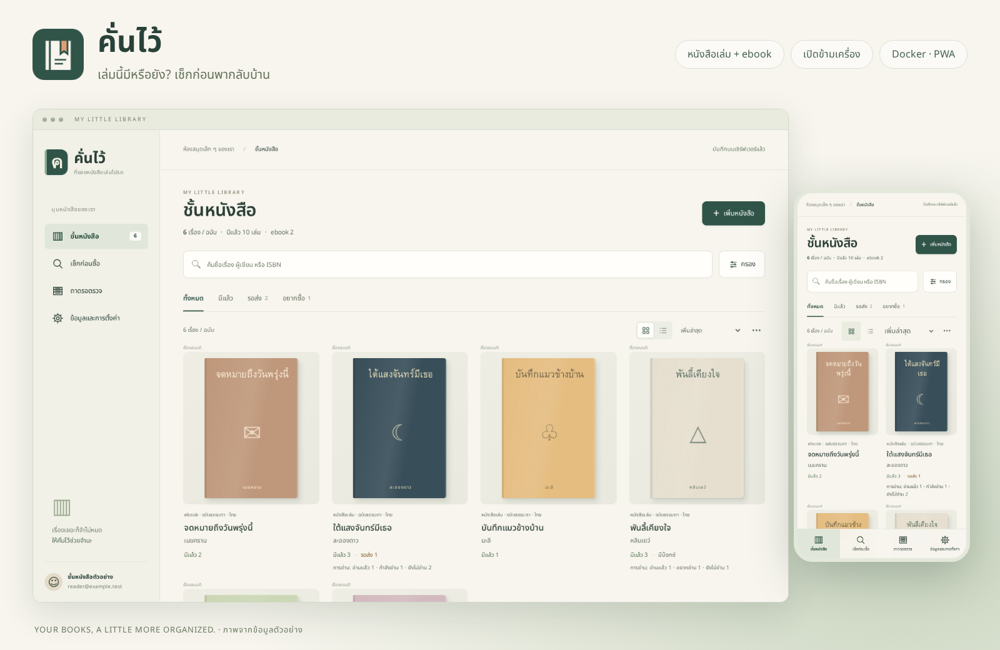
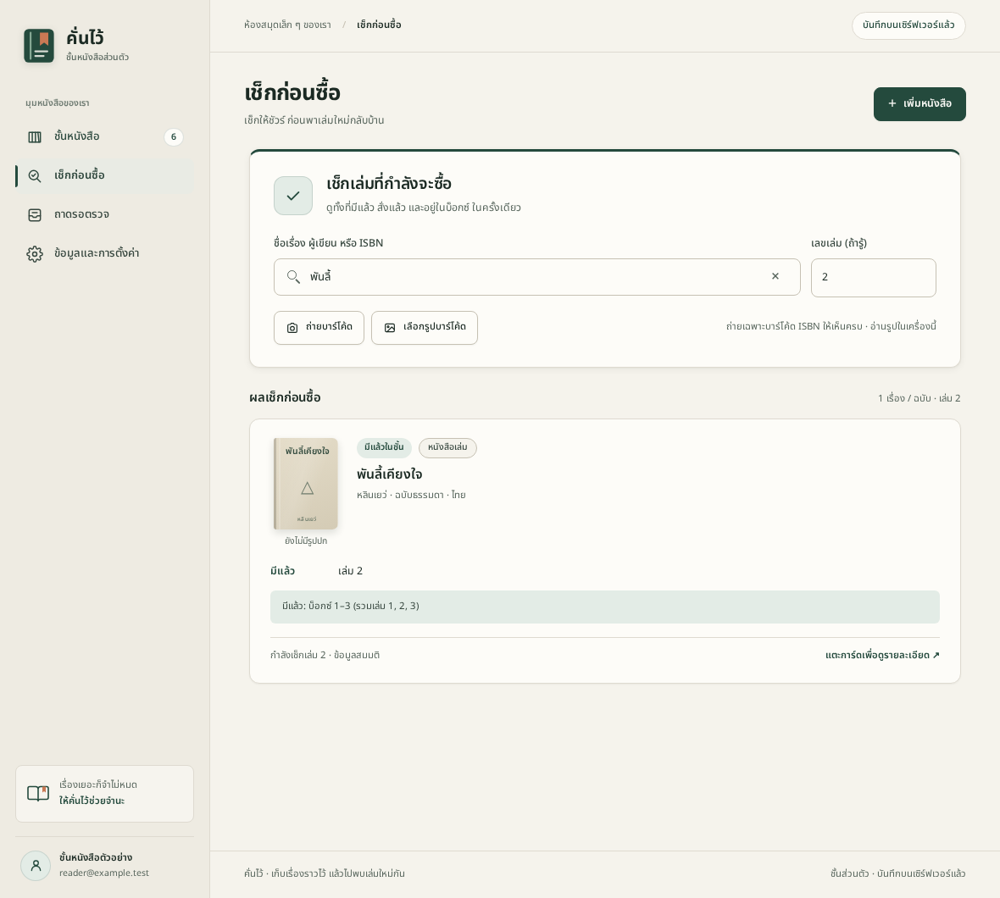
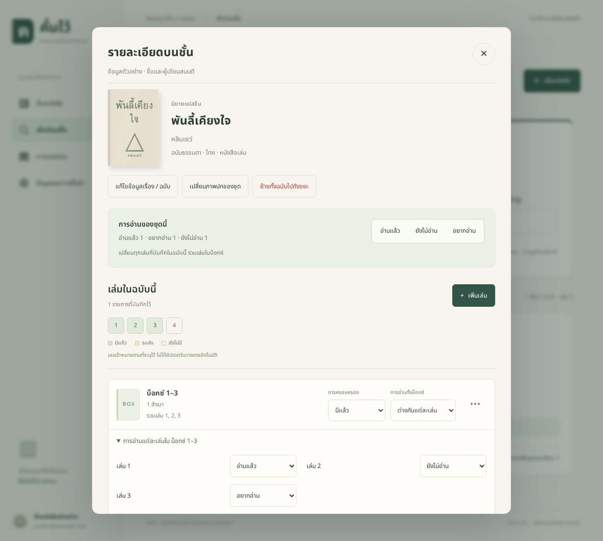
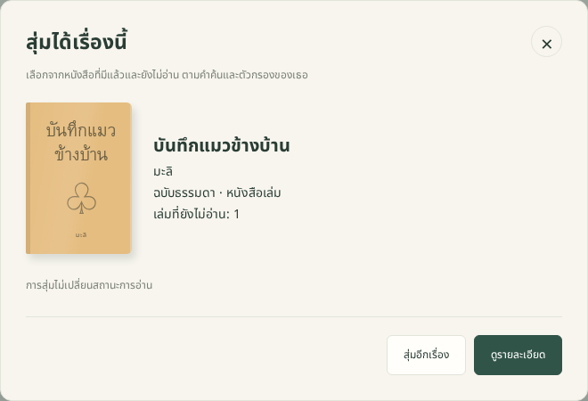

<h1 align="center">คั่นไว้</h1>

<p align="center">
  <strong>เล่มนี้มีหรือยัง? เช็กก่อนพากลับบ้าน</strong><br>
  ชั้นหนังสือส่วนตัวสำหรับการ์ตูน นิยาย และ ebook ที่เริ่มเยอะจนจำไม่หมด
</p>

<p align="center">
  Self-hosted · Docker · SQLite · PWA<br>
  <a href="#เริ่มใช้ด้วย-docker">เริ่มใช้งาน</a> ·
  <a href="#ภาพหน้าจอ">ภาพหน้าจอ</a> ·
  <a href="docs/deployment.md">คู่มือติดตั้งเซิร์ฟเวอร์</a> ·
  <a href="docs/architecture.md">โครงสร้างระบบ</a>
</p>



เก็บหนังสือเล่มกับ ebook ไว้ด้วยกัน เปิดเช็กจากมือถือระหว่างเลือกซื้อ แล้วกลับมาจัดชั้นต่อบนคอมด้วยบัญชีเดียวกัน ข้อมูลอยู่บนเซิร์ฟเวอร์ที่เธอติดตั้งเอง

> ภาพทั้งหมดใช้บัญชี ชื่อหนังสือ และปกตัวอย่างที่สร้างขึ้นสำหรับแนะนำแอพ ไม่ใช่ข้อมูลหรือรูปส่วนตัวของผู้ใช้

## ช่วยอะไรได้บ้าง

| สิ่งที่อยากทำ | คั่นไว้ช่วยยังไง |
| --- | --- |
| **เช็กก่อนซื้อซ้ำ** | ค้นชื่อ ผู้เขียน หรือ ISBN ดูว่ามีแล้ว รอส่ง หรืออยากซื้อ รวมเล่มที่อยู่ในบ็อกซ์ |
| **เพิ่มหนังสือให้ไวขึ้น** | เพิ่มทีละเล่มหรือเป็นชุด วางรูปปกจากคลิปบอร์ด ถ่าย/เลือกรูปบาร์โค้ด ใช้ ISBN ช่วยกรอก แล้วตรวจข้อมูลก่อนบันทึก |
| **จัดชั้นให้หาเจอง่าย** | เรียงชื่อ/วันที่ กรองรูปแบบ หมวด ที่เก็บ และแท็ก สลับปกกับรายการย่อ จัดการหลายรายการ และนำเข้า CSV |
| **เลือกเล่มต่อไปที่จะอ่าน** | ยังไม่อ่าน / อยากอ่าน / กำลังอ่าน / อ่านแล้ว พร้อมสุ่มหนึ่งเรื่องจากเล่มที่มีแล้วและยังไม่อ่าน |
| **เผลอลบก็กลับมาได้** | ถังขยะเก็บรายเล่ม ทั้งฉบับ และรายการรอตรวจ กู้คืนพร้อมรูปและสถานะเดิม มีให้ตรวจเมื่ออาจซ้ำ |
| **ใช้ต่อได้หลายเครื่อง** | บัญชีส่วนตัว ซิงก์ข้ามเครื่อง เปิดข้อมูลที่โหลดไว้และเพิ่มรายการตอนออฟไลน์ มีหน้าตรวจเมื่อข้อมูลแก้ชนกัน |
| **ดูแลข้อมูลเอง** | ส่งออก/นำเข้า JSON พร้อมรูป สำรองและกู้คืน SQLite ผ่าน CLI ใช้หนึ่ง app image กับหนึ่ง data volume |

## ภาพหน้าจอ

<table>
  <tr>
    <td width="50%"><strong>เช็กให้ชัวร์ก่อนซื้อ</strong><br>เห็นว่าเลขเล่มที่หาอยู่ในบ็อกซ์แล้ว<br><br></td>
    <td width="50%"><strong>ดูแลหนังสือเป็นชุด</strong><br>แยกการครอบครองกับการอ่านของแต่ละเล่ม<br><br></td>
  </tr>
</table>

<details>
<summary>อยากอ่าน แต่เลือกไม่ถูก? ดูตัวอย่างการสุ่ม</summary>



สุ่มจากหนังสือที่มีแล้วตามคำค้นและตัวกรอง ไม่เปลี่ยนสถานะการอ่านให้เอง

</details>

## เริ่มใช้ด้วย Docker

เวอร์ชันปัจจุบัน **0.10.3** ต้องมี Docker และ Docker Compose ไม่ต้องติดตั้ง Node หรือฐานข้อมูลแยกบนเซิร์ฟเวอร์

```sh
git clone https://github.com/SurakTH/khanwai.git
cd khanwai
test -e .env || cp .env.example .env
docker build -t khanwai:0.10.3 .
docker compose up -d
```

เปิด **http://localhost:4173** แล้วสมัครบัญชีของตัวเอง บัญชีใหม่เริ่มด้วยชั้นว่าง ไม่มีรหัสผ่านตั้งต้น โหลดข้อมูลตัวอย่างมาลองจากหน้าตั้งค่าได้

- เข้าผ่าน IP เซิร์ฟเวอร์จากมือถือหรือเครื่องอื่น: ตั้ง `BIND_ADDRESS=0.0.0.0` ใน `.env` ก่อนเปิดแอพ
- ใช้โดเมน HTTPS หรือ reverse proxy: ตั้ง `APP_ORIGIN` เป็น URL ของแอพ และ `COOKIE_SECURE=true` ตาม [คู่มือเซิร์ฟเวอร์](docs/deployment.md)
- ใช้ HTTPS สำหรับติดตั้ง PWA จากมือถือหรือเครื่องอื่น ส่วน `.env` จริงเก็บเฉพาะเครื่องของตัวเอง

ตอนนี้ต้อง build image จาก source เอง ยังไม่ได้เผยแพร่ image บน registry ใช้ reverse proxy ที่มีอยู่ได้ Compose ไม่เพิ่ม proxy หรือบริการอื่นให้เอง

### ข้อมูลอยู่ไหน

บัญชี หนังสือ ถังขยะ และรูปเก็บใน named volume `book-data` ที่ `/data` เปลี่ยน container แล้วข้อมูลยังอยู่ ควรสำรองไว้ก่อนอัปเกรดตาม [คู่มือ backup/restore](docs/deployment.md#สำรองข้อมูล)

```sh
docker compose logs -f
docker compose down
```

**อย่าใช้ `docker compose down -v` กับข้อมูลจริง** เพราะจะลบ volume ด้วย

## คู่มือใช้งาน

| เรื่อง | อ่านต่อ |
| --- | --- |
| ติดตั้ง อัปเดต HTTPS ย้ายเครื่อง และกู้ข้อมูล | [Docker และเซิร์ฟเวอร์](docs/deployment.md) |
| จัดชั้น เลือกหลายรายการ และนำเข้า CSV | [การจัดการชั้นหนังสือ](docs/reference/shelf-management.md) |
| สถานะการอ่านและเล่มในบ็อกซ์ | [การอ่าน](docs/reference/reading-status.md) |
| รายละเอียดฉบับ แก้ข้อมูล และเปลี่ยนปก | [รายละเอียดหนังสือ](docs/reference/book-details.md) · [วางรูปปก](docs/reference/cover-paste.md) |
| หมวดหมู่ส่วนตัวและหมวดเริ่มต้น | [จัดการหมวดหมู่](docs/reference/categories.md) |
| สุ่มเรื่องที่ยังไม่อ่าน และถังขยะ | [สุ่มและกู้คืน](docs/reference/trash-and-picker.md) |

### เรื่องที่ควรรู้ก่อนใช้

- ISBN เป็นตัวช่วยค้น ไม่รับประกันว่าจะมีข้อมูล โดยเฉพาะหนังสือไทย เลือก Google Books, Open Library และ NLT แบบทดลองในตั้งค่าได้ มีทางกรอกเองเสมอ
- บาร์โค้ดใช้ภาพถ่ายหรือรูปในเครื่อง ยังไม่ใช่การเล็งกล้องอ่านต่อเนื่อง
- รองรับ flow ของ iPhone และ Android การทดสอบอัตโนมัติใช้ Chromium desktop/mobile emulation ยังต้องตรวจกล้อง Safari/iOS, Android และการติดตั้ง PWA บนเครื่องจริง
- ถังขยะเก็บรายการที่ลบตั้งแต่ 0.10.0 ไม่มีลบอัตโนมัติ รายการที่ลบจริงก่อนหน้านั้นต้องใช้ข้อมูลสำรอง
- ยังไม่มี AI อ่านรูป และไม่มีเว็บ demo สาธารณะให้ทดลอง ข้อมูลตัวอย่างในภาพอยู่บน instance ชั่วคราวเท่านั้น

<details>
<summary>ถ้าเคยใช้ต้นแบบที่เก็บข้อมูลในเบราว์เซอร์</summary>

ข้อมูลเดิมไม่ถูกลบหรือรวมเข้าบัญชีอัตโนมัติ หลังสมัคร/เข้าสู่ระบบ ไป **ข้อมูลและการตั้งค่า → ตรวจและนำเข้าข้อมูลเดิม** ดู preview แล้วค่อยยืนยัน ดาวน์โหลดต้นฉบับเก็บไว้ได้ด้วย ต้องเปิด origin เดิมจึงจะเห็นข้อมูลเดิม หรือใช้ไฟล์ JSON ที่ส่งออกไว้

</details>

## สำหรับผู้พัฒนา

Vanilla HTML/CSS/JavaScript + Node.js **24.22.2** + SQLite ไม่มี frontend build step สำหรับเริ่มแอพ อ่าน [AGENTS.md](AGENTS.md) ก่อนแก้ไข

```sh
npm ci
npm run dev
npm test
npx playwright install chromium
npm run test:e2e
```

Linux ต้องมี system dependencies ของ Chromium ด้วย ชุด browser test ใช้เซิร์ฟเวอร์และฐานข้อมูลชั่วคราวแยก desktop/mobile ที่ 4187 และ 4188 อย่าชี้การทดสอบไปยัง instance ที่มีข้อมูลจริง

<details>
<summary>สร้างภาพ README และตรวจ Docker</summary>

```sh
node tests/preview-readme.mjs
node tests/docker-smoke.mjs
```

ภาพ README อยู่ใน `docs/images/readme/` สคริปต์สร้างบัญชี/ฐานชั่วคราวพร้อมปก CSS ของแอพ และลบฐานนั้นเมื่อเสร็จ ไม่อ่านบัญชี รูป หรือฐานข้อมูลจริง ภาพพัฒนาระหว่างงานใน `docs/screenshots/` ยังไม่รวมใน repository

Docker smoke ใช้ scratch Compose project/volume ของตัวเองที่พอร์ต 4197 และลบเฉพาะข้อมูลทดสอบเมื่อเสร็จ

</details>

อ่านต่อที่ [สารบัญเอกสาร](docs/README.md) หรือ [เอกสารการพัฒนา](docs/development/README.md) สำหรับแผน เหตุผลในการออกแบบ และประวัติแต่ละรุ่น
