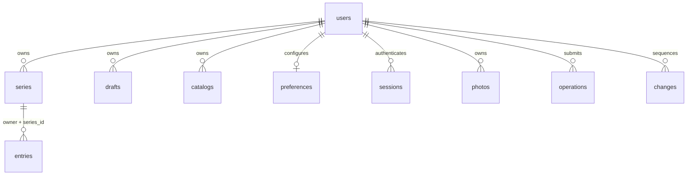

# ข้อมูลและฐานข้อมูลที่ใช้จริง

ตรวจเทียบกับซอร์ส **0.10.3** — 31 ตุลาคม 2026 · [สารบัญ](README.md) · [ภาพรวมเว็บ](18-system-overview.md)

## ข้อมูลอยู่ที่ไหน

| ที่เก็บ | เก็บอะไร | บทบาท |
| --- | --- | --- |
| SQLite: `/data/library.sqlite` | บัญชี, session hash, รายการหนังสือ, หมวด, settings, revisions และประวัติซิงก์ | ข้อมูลกลางที่เซิร์ฟเวอร์ยืนยันแล้ว |
| ไฟล์ `/data/photos/OWNER/HASH.ext` | รูปส่วนตัวของบัญชี | SQLite เก็บเพียง metadata/ตำแหน่งไฟล์ ไม่เก็บเนื้อภาพเป็น BLOB |
| IndexedDB ในแต่ละ browser | สำเนาชั้นเต็ม, revisions, outbox, conflict | เปิดข้อมูลเดิม/ทำงานที่รองรับตอนออฟไลน์ รอส่งเซิร์ฟเวอร์ |
| Cache Storage ในแต่ละ browser | ไฟล์แอพ และรูปส่วนตัวที่เคยโหลด แยกตามบัญชี | ใช้งาน PWA ออฟไลน์ ไม่ใช่ backup |
| localStorage | บัญชีที่ใช้ล่าสุดและค่ามุมมอง/การเรียงต่อบัญชี | ไม่มีรหัสผ่านหรือ session token |

Docker มี volume `book-data` mount ที่ `/data`; รัน Node ตรงใช้ `DATA_DIR` หรือ `./data` ค่าเริ่มต้น ไฟล์ SQLite WAL/SHM อาจเกิดข้างฐานข้อมูลขณะเปิดใช้งาน อย่าคัดลอกเฉพาะไฟล์หลักขณะรันเพื่อถือว่าเป็น backup ที่สมบูรณ์ ใช้คำสั่งสำรองตาม [คู่มือ Docker](09-docker.md)

## โมเดลที่แอพใช้

ระบบจริง **ยังไม่มีตาราง Work/Edition/Volume/BoxSet แยกตามแบบตั้งต้นใน 03** ใช้โครงสร้างนี้:

- **series** = เรื่องพร้อมฉบับ ภาษา และรูปแบบ เช่น เรื่องเดียวกันฉบับกระดาษกับ ebook เป็นคนละ series
- **entry** = รายการเล่มเดี่ยวหรือบ็อกซ์ภายใน series พร้อมจำนวนและสถานะการครอบครอง
- **draft** = ข้อมูลในถาดรอตรวจ ยังไม่ใช่หนังสือที่ยืนยันเข้าชั้น
- **categories** = รายชื่อหมวดที่บัญชีตั้งเอง ลำดับแรกเป็นค่าเริ่มต้น

`series.entries` เป็นโครงสร้างที่เว็บใช้ แต่เมื่อซิงก์/ลง SQL จะแยกเป็น record ต่อรายการ ไม่เก็บชั้นทั้งบัญชีเป็น JSON ก้อนเดียว

## ตัวอย่างข้อมูลชั้นฉบับเต็ม

ตัวอย่างสมมติ ไม่มีข้อมูลส่วนตัวหรือรูปผู้ใช้ สามารถส่งผ่าน `validateState` ได้:

```json
{
  "schemaVersion": 2,
  "categories": ["นิยายแปลจีน", "การ์ตูน"],
  "series": [
    {
      "id": "11111111-1111-4111-8111-111111111111",
      "title": "จดหมายในฤดูฝน",
      "author": "นักเขียนตัวอย่าง",
      "alias": "",
      "edition": "ฉบับธรรมดา",
      "language": "ไทย",
      "category": "นิยายแปลจีน",
      "format": "physical",
      "target": ["1", "2", "3"],
      "tags": ["เล่มโปรด"],
      "entries": [
        {
          "id": "22222222-2222-4222-8222-222222222222",
          "kind": "volume",
          "label": "1",
          "isbn": "",
          "status": "owned",
          "quantity": 1,
          "readingStatus": "read",
          "location": "ตู้ A"
        },
        {
          "id": "33333333-3333-4333-8333-333333333333",
          "kind": "box",
          "label": "บ็อกซ์ 2–3",
          "members": ["2", "3"],
          "isbn": "",
          "status": "owned",
          "quantity": 1,
          "readingStatus": "unread",
          "readingByMember": {"2": "planned", "3": "unread"}
        }
      ]
    }
  ],
  "drafts": [
    {
      "id": "44444444-4444-4444-8444-444444444444",
      "title": "นิยายในถาดรอตรวจ",
      "author": "",
      "isbn": "",
      "label": "",
      "edition": "ฉบับธรรมดา",
      "language": "ไทย",
      "category": "การ์ตูน",
      "format": "ebook",
      "source": "กรอกเอง",
      "readingStatus": "unread"
    }
  ]
}
```

## ความหมายของ fields

| ระดับ | ข้อมูลหลัก | กติกา |
| --- | --- | --- |
| root | `schemaVersion`, `series`, `drafts`, optional `categories` | JSON รุ่น 2; series ไม่เกิน 5,000, drafts ไม่เกิน 1,000 |
| series | `id`, `title`, `author`, `alias`, `edition`, `language`, `category`, `format`, `entries` | title/edition/language/category ไม่ว่าง; format เป็น `physical` หรือ `ebook`; author/alias ว่างได้ |
| series เพิ่มเติม | `target`, `tags`, `metadataSeed`, `coverData`, `location`, timestamps | target คือเลขเล่มที่ระบุเอง ไม่ใช่จำนวนที่ออกขายจริง; tags อยู่ระดับเรื่อง |
| entry | `id`, `kind`, `label`, `isbn`, `status`, `quantity` | kind `volume`/`box`; quantity จำนวนเต็ม 1–999; ISBN ว่างได้ |
| box | `members` | array ของ **label เล่ม** เช่น `"2"` ไม่ใช่ ID; ไม่มีตารางสมาชิกแยก |
| การอ่าน | `readingStatus`, `readingByMember` | ใช้ได้ใน entry/draft ตาม flow; member override ใช้เฉพาะ box และต้องเป็นชื่อสมาชิกที่มีอยู่ |
| ข้อมูลเสริม | `coverData`, `location`, `createdAt`, `updatedAt`, `trashedAt` | fields ที่เกี่ยวข้องอาจไม่มีในข้อมูลเก่า; location ไม่เกิน 150 ตัวอักษร |
| draft | `id`, `title`, `author`, `isbn`, `label`, `edition`, `language`, `category`, `format`, `source` | fields ข้อความหลักเป็น string และว่างได้ เพื่อให้รอตรวจต่อได้ |

ข้อจำกัดละเอียดดู [validateState](../public/lib.js) ซึ่งใช้ทั้ง server/client: ID ไม่เกิน 100 ตัวและไม่ซ้ำข้าม series/entries/drafts ภายใน state; ข้อความหลัก series ไม่เกิน 300 ตัว, entry label ไม่เกิน 80, entries ต่อเรื่องไม่เกิน 5,000; target/members ไม่เกิน 1,000 labels และ tags ไม่เกิน 30 ค่า ค่าที่ไม่อยู่ในตารางนี้ไม่ได้แปลว่าถูกปฏิเสธทั้งหมด validator ไม่ใช่ strict unknown-field schema สำหรับทุก entity

### สถานะ 3 เรื่องต้องแยกกัน

| เรื่อง | ค่า | ตัวอย่าง |
| --- | --- | --- |
| รูปแบบ | `physical`, `ebook` | หนังสือกระดาษหรือไฟล์อิเล็กทรอนิกส์ |
| การครอบครอง | `owned`, `ordered`, `wishlist` | มีแล้ว / รอส่ง / อยากซื้อ |
| การอ่าน | `unread`, `planned`, `reading`, `read` | ยังไม่อ่าน / อยากอ่าน / กำลังอ่าน / อ่านแล้ว |

ไม่มี readingStatus หรือเป็นค่าว่าง ให้ **คำนวณว่า unread ตอนแสดงผล** ไม่เขียนทับข้อมูลเก่าและไม่เปลี่ยน ownership สมาชิก box ใช้ readingByMember override; ห้ามสร้าง owned entry เดี่ยวเพิ่มเพื่อเก็บสถานะสมาชิก เพราะจะนับซ้ำ ดู [12](12-reading-status.md)

บ็อกซ์ครอบคลุมเลขเล่มตาม members; การเช็กซ้ำรวม coverage ของ box กับเล่มเดี่ยวและไม่ถือว่ามีเล่ม 1–10 เพียงเพราะพบ label 10 เลข ISBN ตรวจ checksum/normalize ก่อนจับคู่ แต่เป็นรหัสสิ่งพิมพ์ ไม่ใช่ ID สำเนาของผู้ใช้ และไม่รับประกันว่าจะค้น metadata ได้ `metadataSeed.isbn` ผูกกับ label ที่ใช้เป็นต้นข้อมูลชุด ไม่ถือว่าเป็นเจ้าของและไม่กระจายไปทุก entry

### หมวดและค่าเริ่มต้น

`categories` เป็น optional array 1–100 ชื่อ; ถ้าไม่เคยตั้งใช้หมวดเริ่มต้นเดิม การแสดงตัวเลือกใช้ `categoryList/categoryOptions` รวมชื่อที่ยังถูกอ้างจาก series/drafts เก่า ลำดับแรกของ catalog ที่ตั้งเป็นหมวดเริ่มต้น การเปลี่ยนชื่อ/ลบหมวดต้องย้าย series และ drafts ที่เกี่ยวข้องใน mutation เดียว ไม่แก้ entries และไม่ทิ้งรายการในถังขยะ ดู [15](15-categories.md)

## ตาราง SQLite ทั้งหมด

ฐานข้อมูลใช้ `STRICT` tables, WAL, foreign keys และ transaction `BEGIN IMMEDIATE` โครงสร้างอยู่ใน [src/storage.mjs](../src/storage.mjs) ไม่มี ORM

| ตาราง | คอลัมน์ | Key / หน้าที่ |
| --- | --- | --- |
| `users` | id, email, name, password_hash, created_at, cursor | PK id; email unique; cursor ลำดับเปลี่ยนแปลงต่อบัญชี |
| `sessions` | token_hash, owner, expires_at | PK token_hash; owner → users; เก็บ hash ไม่ใช่ raw cookie |
| `series` | owner, id, data, revision, deleted | PK (owner,id); owner → users; data เป็น JSON ของเรื่อง **ไม่มี entries ซ้อน** |
| `entries` | owner, id, series_id, data, revision, deleted | PK (owner,id); FK (owner,series_id) → series(owner,id) แบบ deferred |
| `drafts` | owner, id, data, revision, deleted | PK (owner,id); owner → users |
| `catalogs` | owner, id, data, revision, deleted | PK (owner,id); owner → users; ปัจจุบันใช้ id `categories` เท่านั้น |
| `preferences` | owner, data, revision | PK owner → users; ตั้งค่าแหล่ง ISBN แยกจาก library outbox |
| `operations` | owner, id, request_hash, result, created_at | PK (owner,id); owner → users; จำผลเพื่อกันการส่งซ้ำ |
| `changes` | owner, cursor, entity_key, data | PK (owner,cursor); owner → users; change log สำหรับ delta |
| `photos` | owner, id, mime, relative_path | PK (owner,id); owner → users; metadata ไฟล์รูป |
| `rate_limits` | bucket, attempts, expires_at | PK bucket; bucket ถูก hash; จำกัดคำขอ ไม่ใช่รายการชั้น |
| `maintenance` | id, token, expires_at | PK id ต้องเป็น 1; lease ขณะสำรองข้อมูล |

`data` และ `operations.result` เป็น JSON text ที่ SQL ตรวจ json_valid; `changes.data` เป็น null ได้เมื่อ record ถูกนำออก แต่ละ entity มี revision ของตัวเองซึ่งได้จาก cursor บัญชีที่เพิ่มทีละ change ไม่ใช่เลขรุ่นแอพหรือเวลาจากเครื่องผู้ใช้ entries มีทั้งคอลัมน์ series_id และ field seriesId ใน sync JSON



ERD นี้ย่อความสัมพันธ์จริง ไม่ได้เพิ่ม FK ตรงจาก entries ไป users; entries ตรวจเจ้าของผ่าน composite FK ของ series `rate_limits`/`maintenance` เป็นตารางควบคุมระดับระบบจึงไม่อยู่ในแผนภาพ

## ถังขยะกับการนำ record ออกจากชุดข้อมูล

สองอย่างนี้มีความหมายต่างกัน:

| กลไก | เก็บอย่างไร | ผล |
| --- | --- | --- |
| ถังขยะที่ผู้ใช้กด | ใส่ `trashedAt` ISO ใน JSON ของ series/entry/draft; SQL deleted ยังเป็น 0 | ยังอยู่ใน raw state/export/backup กู้คืน ID เดิมได้ |
| sync tombstone | change `value: null`; SQL deleted = 1 และเก็บ revision/ข้อมูลเดิม | ไม่รวม record ใน snapshot.state แต่เก็บเวอร์ชันไว้กันการส่งเก่าทับ |

หน้าชั้นใช้ `activeLibrary` ที่ซ่อนรายการถังขยะเท่านั้น **ห้ามนำ projection นี้ไป persist ทับ raw state** เพราะจะทำถังขยะหาย ลบทั้งเรื่องแล้วคืนเรื่องจะไม่คืน child ที่เคยลบแยกมาก่อนโดยอัตโนมัติ ไม่มีล้างถังขยะอัตโนมัติหรือปุ่มลบถาวร ดู [16](16-trash-and-picker.md)

## วงจรรูปปก

1. เลือก/ถ่าย/วางภาพ → browser ตรวจชนิดและขนาด แล้วย่อด้านยาวไม่เกิน 720px เป็น JPEG
2. ก่อนยืนยัน รูปอยู่ในพรีวิว/ข้อมูลรอส่งแบบ data URI ยังไม่ใช่ไฟล์ที่ server เก็บแล้ว
3. เมื่อส่ง operation server ตรวจ bytes และ owner สร้าง hash จาก owner + bytes เขียนไฟล์ `photos/OWNER/HASH.ext` และ metadata ในตาราง photos
4. ข้อมูลที่ server ยืนยันใช้ `coverData: "/api/photos/HASH"` การอ่านรูปต้องมี session และ owner ตรงกัน ไม่มี static public photo directory
5. portable JSON export แปลง reference กลับเป็น data URI เพื่อย้ายไปบัญชี/เครื่องอื่นได้

ไฟล์เก่าที่ลงทะเบียนแล้วไม่ได้ถูกล้างทันทีเมื่อเปลี่ยนปก และ backup เก็บ registered photos ทั้งหมด การลบบัญชีลบข้อมูลและโฟลเดอร์รูปเจ้าของนั้น ภาพบาร์โค้ดอ่านในเครื่อง ไม่กลายเป็นรูปปกหรืออัปโหลดโดยอัตโนมัติ ดู [17](17-cover-paste.md)

## สำเนาในเบราว์เซอร์และการสำรอง

- IndexedDB `khanwai-accounts-v1` version 1, store `accounts`, key เป็น user ID: เก็บ `{state, versions, cursor, outbox, lastSynced, conflict, generation}` แยกบัญชี
- localStorage `khanwai-last-user-v1` เก็บ public user; `khanwai-shelf-order-v1:OWNER` / `khanwai-shelf-view-v1:OWNER` เก็บการแสดงผล; `khanwai-prototype-v1` เป็นข้อมูล legacy ที่ต้องนำเข้าเอง
- Cache Storage แยก private photos เป็น `khanwai-private-OWNER`; cache ที่ผูก client กับ owner ใช้ควบคุมการอ่านรูปออฟไลน์ ไม่ใช่ช่องทางข้ามบัญชี
- **portable JSON** เป็นข้อมูลชั้น หมวด ถังขยะ และรูป ไม่รวมบัญชี รหัสผ่าน session หรือ preferences แหล่ง ISBN; export ในเว็บรองรับข้อมูล local ส่วน `/api/export` ส่งข้อมูลที่ server มี
- **server backup** เป็น SQLite + registered photos + manifest/checksums รวมข้อมูลทุกบัญชี/settings ใช้ CLI เมื่อย้ายเซิร์ฟเวอร์; restore ลง directory ว่างและยกเลิก sessions เดิม ต้อง login ใหม่

สำเนาใน browser ไม่เข้ารหัสแยกจาก profile ของผู้ใช้เครื่อง และไม่แทน backup เมื่อล้างข้อมูลเว็บไซต์สำเนา/outbox อาจหาย ดูลำดับ ACK/conflict ใน [20](20-api-and-sync.md) และขั้นตอน backup/restore ใน [09](09-docker.md)

## เลขเวอร์ชันที่ไม่ใช่สิ่งเดียวกัน

| ชนิด | ปัจจุบัน | ใช้ทำอะไร |
| --- | --- | --- |
| แอพ | 0.10.3 | รุ่นโค้ด/image |
| SQLite `PRAGMA user_version` | 3 | migration ตารางใน server |
| Library JSON `schemaVersion` | 2 | รูปแบบชั้น/import/export |
| IndexedDB | 1 | โครงสร้าง cache ใน browser |
| Backup manifest | 1 | รูปแบบรายการไฟล์/checksum |

Service Worker มีเลข cache shell ของตัวเอง เป็นรายละเอียดการอัปเดต assets ไม่ใช่ migration หนังสือ หากเปลี่ยนโมเดลข้อมูลต้องตรวจ validator, sync-core, storage, import/export และ backup ร่วมกัน ไม่อัปเกรดเลขทั้งหมดตามเลขแอพโดยอัตโนมัติ
