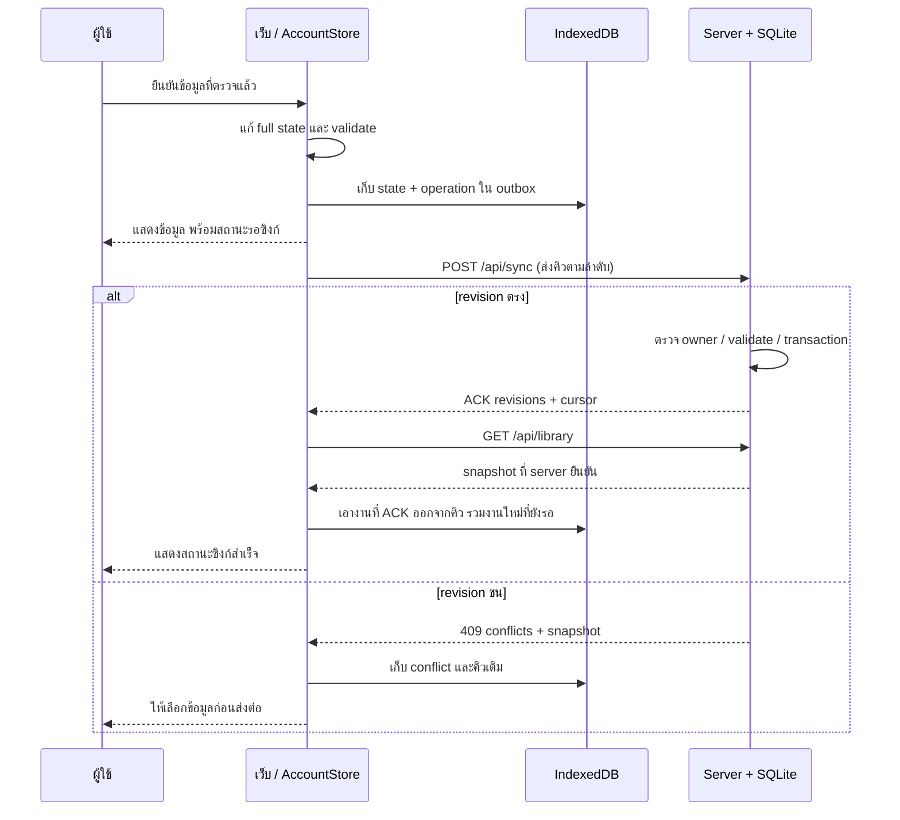

# API บัญชี และการซิงก์

รายละเอียดจากซอร์ส · [สารบัญ](../README.md) · [โครงสร้างข้อมูล](data-and-storage.md)

เอกสารนี้อธิบาย API ภายในที่เว็บใช้อยู่ ไม่ใช่ API key service สำหรับแอพภายนอก แหล่งอ้างอิงหลักคือ [server.mjs](../../server.mjs), [storage.mjs](../../src/storage.mjs), [account-store.js](../../public/account-store.js) และ [sync-core.js](../../public/sync-core.js)

## Request และบัญชี

เว็บเรียก API บน origin เดียวกัน ใช้ cookie `khanwai_session` แบบ HttpOnly, SameSite=Lax และ Secure เมื่อกำหนด HTTPS ผ่าน APP_ORIGIN/COOKIE_SECURE Session อายุ 7 วัน; server เก็บ SHA-256 ของ token ใน SQL ไม่เก็บ raw token รหัสผ่านใช้ scrypt พร้อม salt ไม่มี JWT, magic link หรือ email reset service

คำขอที่เปลี่ยนข้อมูลต้องมี `X-Book-Request: 1` และ `Content-Type: application/json` ตรวจ Origin ถ้ามี และปฏิเสธ cross-site Header นี้ไม่แทนการ login เจ้าของข้อมูลมาจาก session ฝั่ง server ไม่เชื่อ owner ที่ browser ส่งมา ใน settings จะตรวจ owner ใน body ซ้ำเพื่อจับกรณีสลับบัญชี

`APP_ORIGIN` ต้องตรง URL ที่เปิดใช้จริงเมื่ออยู่หลัง HTTPS proxy ดู [.env.example](../../.env.example) และ [คู่มือเซิร์ฟเวอร์](../deployment.md) ไม่จำเป็นต้องเพิ่ม proxy อีกตัวใน Compose

## เส้นทางที่มีอยู่จริง

ทุก `/api/` ด้านล่างต้องมี session ยกเว้น config/register/login; `/healthz` เปิดตรวจสถานะได้

| Method / path | ข้อมูลเข้า | ผลสำเร็จ / หน้าที่ |
| --- | --- | --- |
| GET/HEAD `/healthz` | — | `{status:"ok", database:"sqlite"}`; health endpoint ไม่ใช่การตรวจทุกตารางเชิงลึก |
| GET `/api/config` | — | `{registration}` เปิดให้สมัครหรือไม่ |
| POST `/api/auth/register` | `{email,name,password}` | สร้างบัญชี/ออก session; ปิดได้ด้วย ALLOW_REGISTRATION |
| POST `/api/auth/login` | `{email,password}` | ตรวจรหัสผ่าน/ออก session |
| GET `/api/auth/me` | — | `{user}` เฉพาะ id/email/name |
| POST `/api/auth/logout` | `{}` | ถอน session ปัจจุบัน/ล้าง cookie |
| POST `/api/auth/password` | `{currentPassword,password}` | เปลี่ยนรหัส ถอน sessions เดิม แล้วออก session ใหม่ให้เครื่องนี้ |
| DELETE `/api/account` | `{password}` | ตรวจรหัสแล้วลบบัญชี รายการ และรูปของเจ้าของ |
| GET `/api/library` | — | `{state,versions,cursor}` snapshot เต็มรวมถังขยะ |
| GET `/api/sync?after=N` | cursor ล่าสุด | `{cursor,changes}` delta ตามลำดับบัญชี |
| POST `/api/sync` | operation ด้านล่าง | `{versions,cursor}`; replay มี `replayed:true` เพิ่ม |
| GET `/api/settings` | — | `{owner,isbnProviders,revision}` |
| PUT `/api/settings` | `{owner,isbnProviders,revision}` | settings ใหม่พร้อม revision; ต้องออนไลน์และ revision ตรง |
| GET `/api/isbn?isbn=...` | ISBN ที่ผู้ใช้สั่งค้น | status/candidates จาก provider ที่บัญชีเปิดไว้ |
| GET `/api/photos/HASH` | hash 64 hex | bytes รูปของเจ้าของ session; header X-Book-Owner สำหรับ private cache |
| GET `/api/export` | — | portable JSON attachment จากข้อมูล server พร้อม inline รูป |

ไม่ได้มี CRUD endpoint แยก `/books/:id` แต่ส่งการเพิ่ม/แก้/ย้ายถังขยะ/กู้คืนผ่าน `/api/sync` เดิม ไม่มี upload รูปแยก รูปแนบมากับ entity ใน operation

## Snapshot กับ sync records

`state` เป็น nested library ตาม [ข้อมูลและที่เก็บ](data-and-storage.md) ส่วน `versions` เป็น object จาก record key ไป revision และ cursor เป็นลำดับล่าสุดของบัญชี การแปลงใช้ flattenLibrary/expandLibrary:

| Key | value |
| --- | --- |
| `series:ID` | ข้อมูล series โดยนำ entries ออก |
| `entry:ID` | ข้อมูล entry เพิ่ม `seriesId` อ้าง parent |
| `draft:ID` | ข้อมูล draft |
| `catalog:categories` | `{id:"categories",names:[...]}` |

snapshot.state ไม่รวม SQL tombstone แต่ versions ยังรวมเวอร์ชัน tombstone เพื่อกันข้อมูลเก่ากลับมา ถังขยะเป็น JSON trashedAt จึงยังอยู่ใน state

## ตัวอย่างเพิ่มเล่มผ่าน operation

ตัวอย่างนี้ต่อจาก series ใน [ข้อมูลและที่เก็บ](data-and-storage.md) เลข ID เป็นตัวอย่างเท่านั้น ในเว็บสร้างใหม่ผ่าน [ids.js](../../public/ids.js) เสมอ ไม่ใช้ ISBN เป็น ID

```json
{
  "id": "66666666-6666-4666-8666-666666666666",
  "changes": [
    {
      "key": "entry:55555555-5555-4555-8555-555555555555",
      "baseRevision": 0,
      "value": {
        "id": "55555555-5555-4555-8555-555555555555",
        "seriesId": "11111111-1111-4111-8111-111111111111",
        "kind": "volume",
        "label": "4",
        "isbn": "",
        "status": "owned",
        "quantity": 1,
        "readingStatus": "unread"
      }
    }
  ]
}
```

`baseRevision:0` หมายถึงคาดว่ายังไม่มี record นี้ ถ้าข้อมูลตัวอย่างใน 19 เป็น 5 records แรกที่บันทึกบนบัญชีว่าง ผลเพิ่มเล่มนี้คือ:

```json
{
  "versions": {"entry:55555555-5555-4555-8555-555555555555": 6},
  "cursor": 6
}
```

แก้ record เดิมใช้ baseRevision ที่เคยอ่าน ถ้าการแก้ในเครื่องอาศัย operation ที่ยังรอ ACK ใช้ `{ "operationId": "ID ของ operation ก่อนหน้า" }` แทนเลขได้ server จะแก้เป็น revision จากผลของ operation ก่อนหน้าที่เป็นของเจ้าของเดียวกัน

### สิ่งที่ server ตรวจ

1. จำกัดรูปแบบ operation/key/จำนวน changes และไม่ให้ key ซ้ำใน operation เดียว
2. ตรวจ operation ID + request hash: ส่งซ้ำเหมือนเดิมคืนผลเดิม; ใช้ ID เดิมแต่ payload เปลี่ยนคืน 409 `operation_reused`
3. เปรียบเทียบ base revisions ทุก record กับสถานะปัจจุบัน ถ้าชนคืน 409 พร้อม conflicts/snapshot ไม่เขียนบางส่วน
4. รวม changes แล้วตรวจโครงสร้างเต็มด้วย expandLibrary/validateState รวม parent ของ entries และหมวด
5. ตรวจ/ลงทะเบียนรูปของ owner เขียน records, revisions, change log และผล operation ใน transaction เดียว

SQLite transaction ครอบคลุมข้อมูล SQL แต่ filesystem ไม่ได้ rollback ตาม SQL ไฟล์ที่เขียนแล้วก่อน rollback อาจค้างโดยไม่มี photo row; ไม่ถูกเสิร์ฟเป็นรูปบัญชีและไม่รวมใน registered-photo backup ไม่ควรอ้างว่า SQL กับไฟล์เป็น transaction เดียวกัน

revision เพิ่มตาม cursor ของบัญชี **ต่อ change** ไม่ได้ใช้เวลาของมือถือเลือกใครชนะ ไม่มี last-write-wins เงียบ ๆ Operation รับไม่เกิน 12,000 changes; body sync จำกัด 50 MiB ส่วน body auth/settings จำกัด 16 KiB

## กดบันทึกแล้วเกิดอะไร



AccountStore ทำ mutation เป็นลำดับและตรวจ generation ของ cache ก่อนเขียน กันแท็บเก่าทับข้อมูลที่อีกแท็บเขียนแล้ว หลัง ACK จะรวม snapshot กับคีย์ที่ยังรอใน outbox เพื่อไม่ทิ้งการแก้ล่าสุดในเครื่อง

## ออฟไลน์ การกลับมาออนไลน์ และ conflict

- เคย login และโหลดข้อมูลแล้วจึงใช้สำเนาของบัญชีนั้นตอนเครือข่ายล่มได้ การสมัคร/เข้าครั้งแรกต้องออนไลน์; 401 ไม่ถือว่า login สำเร็จด้วย cache
- งานที่รองรับออฟไลน์เก็บ state/outbox ก่อนแสดงว่ารอซิงก์ ส่ง FIFO ด้วย operation ID เดิมเมื่อ retry เพื่อกันเพิ่มซ้ำ
- ซิงก์เมื่อ boot/login, กลับออนไลน์, focus ตามเงื่อนไขหน้า, ผู้ใช้กดเอง และทุก 15 วินาทีเมื่อหน้า visible/ไม่มี modal ตาม guard ไม่ใช่ WebSocket หรือ background worker ที่รับประกันทำงานหลังปิดเว็บ
- ดึง delta หลังส่งคิว; cursor ใช้ไม่ได้จะโหลด snapshot เต็มใหม่
- เมื่อ revision ชน เก็บ conflict และหยุด mutation จนเลือกแก้ชัดเจน จากนั้นอ่าน snapshot ใหม่ สร้าง operation ใหม่บน base ล่าสุด
- Session หมดอายุเก็บงานรอไว้ให้ login บัญชีเดิม ไม่ส่งให้บัญชีอื่น; logout มีงานค้างต้องจัดการหรือยืนยันละทิ้งก่อนล้าง cache
- การตั้งค่า provider ใน preferences ใช้ PUT ออนไลน์ + revision แยก ส่วนหมวดเป็น catalog ใน outbox จึงใช้เส้นทางเดียวกับชั้น

สถานะ “รอส่ง” ไม่ใช่ “บันทึกบน server แล้ว” และ cache ไม่ใช่ backup ที่ย้ายข้ามเครื่องได้เอง การเปิดอีกเครื่องเห็นข้อมูลที่เซิร์ฟเวอร์ได้รับแล้ว

## PWA และรูปออฟไลน์

[sw.js](../../public/sw.js) precache ไฟล์แอพและใช้ network-first สำหรับ shell พร้อม cache fallback ไม่ cache JSON ของทุก API รูปส่วนตัว cache ได้เมื่อ X-Book-Owner จาก server ตรงกับ owner ที่ AccountStore แจ้งให้ client นั้น รูปที่ไม่เคยโหลดไม่ได้รับประกันว่าจะเปิดออฟไลน์ได้ logout สั่งล้าง private cache ของบัญชี

การติดตั้ง PWA กับการซิงก์เป็นคนละเรื่อง HTTPS/config origin สำคัญสำหรับกล้องและ Clipboard API; ยังมีเลือกไฟล์/พิมพ์ ISBN/native paste fallback ตาม capability ไม่ปิด pinch zoom

## ISBN และผลที่ไม่ใช่ข้อผิดพลาด HTTP

provider IDs คือ `google`, `openlibrary`, `nlt`; ค่าเริ่มต้น Google Books/Open Library ส่วน NLT ทดลองและ default-off การค้นมี timeout, fallback, memory cache และพัก provider ที่ติด limit ดู [isbn.mjs](../../src/isbn.mjs) ข้อมูลสาธารณะจาก ISBN ไม่รวมรูป/บันทึกส่วนตัวของผู้ใช้ใน cache ร่วม

HTTP 200 อาจมี domain status `found`, `not_found`, `rate_limited`, `unavailable` หรือ `disabled` ไม่ได้แปลว่าพบหนังสือทุกครั้ง และไม่เหมือน HTTP 429 ของ app เอง ทุก candidate เป็นข้อเสนอ ต้อง review ก่อนเข้าชั้น ไม่มี AI provider/OCR ในระบบจริง API key ถ้ามีตั้ง `GOOGLE_BOOKS_API_KEY` ฝั่ง server ไม่ส่งกลับ browser

## ข้อผิดพลาดที่ client ต้องแยก

รูปแบบ error คือ `{error,message}` และอาจมี `details` ตามกรณี ไม่ให้ UI ตัดสินจากข้อความภาษาไทยเพียงอย่างเดียว

| HTTP | ตัวอย่าง | การจัดการ |
| --- | --- | --- |
| 400 | invalid_operation, invalid_cursor, invalid_settings | ตรวจข้อมูล; cursor ผิดโหลด snapshot ใหม่ |
| 401 | unauthorized | login ใหม่ เก็บงานที่ยังไม่ส่งของเจ้าของเดิม |
| 403 | wrong_owner, origin/header check | ตรวจบัญชี/origin; ไม่เปลี่ยน owner เพื่อข้ามข้อผิดพลาด |
| 409 | conflict, operation_reused, settings_conflict, email_used | จัดการตาม code; ไม่ retry เปลี่ยน payload ใต้ ID เดิม |
| 413 / 415 | body ใหญ่เกิน / content type ผิด | ปรับ request ตามข้อจำกัด |
| 429 | app rate_limited | พักแล้วลองใหม่ตาม flow |
| 503 | maintenance | server กำลังสำรอง ให้ outbox รอซิงก์ |

ดูข้อความ/code จริงจาก source ก่อนเพิ่ม client ภายนอก และดูหลักฐานทดสอบใน [แผนและเกณฑ์ตรวจรับ](../development/roadmap.md), [tests](../../tests) เอกสารนี้เป็นแผนที่การทำงานปัจจุบัน ไม่ใช่คำสัญญาว่า API ภายในจะคงเดิมทุกเวอร์ชัน
