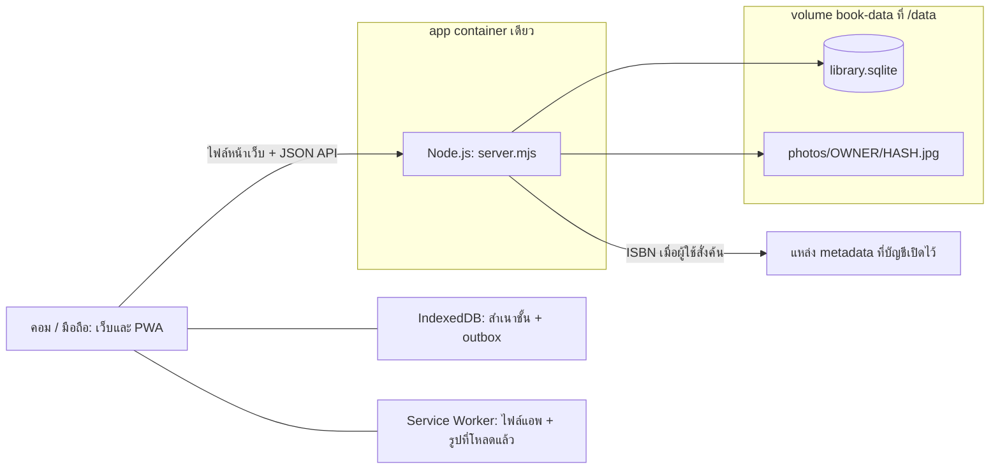

# ภาพรวมเว็บและโครงสร้างโค้ด

รายละเอียดจากซอร์ส · [สารบัญเอกสาร](../README.md)

## เว็บนี้คืออะไร

คั่นไว้เป็นชั้นหนังสือส่วนตัวสำหรับเช็กก่อนซื้อซ้ำ รองรับการ์ตูน นิยาย หนังสือเล่ม และ ebook ผู้ใช้มีบัญชี email/password ของตัวเอง เปิดข้อมูลที่ซิงก์แล้วได้ข้ามคอม/มือถือ และใช้ข้อมูลที่โหลดไว้ตอนออฟไลน์ผ่าน PWA

เมนูหลักมี 4 หน้า: **ชั้นหนังสือ / เช็กก่อนซื้อ / ถาดรอตรวจ / ข้อมูลและการตั้งค่า** การเพิ่ม แก้ไข รายละเอียดชุด ถังขยะ และการสุ่มอ่านเปิดผ่านหน้าหรือ modal เดิม ไม่ใช่แอพย่อยคนละระบบ

## เทคโนโลยีที่ใช้อยู่จริง

| ส่วน | สิ่งที่ใช้ | หลักฐาน |
| --- | --- | --- |
| หน้าเว็บ | HTML/CSS + JavaScript ES modules เขียนตรง ไม่มี React/Vue หรือ frontend router package | [index.html](../../public/index.html), [app.js](../../public/app.js) |
| เซิร์ฟเวอร์ | Node.js HTTP server; Docker pin `24.22.2-alpine` | [server.mjs](../../server.mjs), [Dockerfile](../../Dockerfile) |
| ฐานข้อมูล | SQLite ผ่าน `node:sqlite` ที่มากับ Node; ไม่มี DB container หรือ ORM | [storage.mjs](../../src/storage.mjs) |
| บัญชี | email/password, scrypt, session cookie และ session hash ใน SQLite | [auth.mjs](../../src/auth.mjs) |
| รูปปก | ย่อในเบราว์เซอร์ แล้วเก็บไฟล์ส่วนตัวบนเซิร์ฟเวอร์หลังยืนยัน | [photos.js](../../public/photos.js), [storage.mjs](../../src/storage.mjs) |
| ออฟไลน์ | IndexedDB สำหรับข้อมูล/คิว; Service Worker + Cache Storage สำหรับไฟล์แอพและรูปที่เคยโหลด | [account-store.js](../../public/account-store.js), [sw.js](../../public/sw.js) |
| บาร์โค้ด | ZXing bundle ในเว็บ พร้อมทางพิมพ์ ISBN; ไม่พึ่ง BarcodeDetector อย่างเดียว | [barcode.js](../../public/barcode.js), [build-barcode.mjs](../../scripts/build-barcode.mjs) |
| ISBN metadata | Google Books, Open Library และ NLT แบบทดลอง เลือก/เรียงต่อบัญชี | [isbn.mjs](../../src/isbn.mjs), [provider-options.js](../../public/provider-options.js) |
| ทดสอบ | Node test runner, Playwright และ Docker smoke แบบแยกข้อมูล | [package.json](../../package.json), [tests](../../tests) |

Production server ไม่มี runtime npm dependency เพิ่มเติม; `@playwright/test`, `@zxing/library` และ `esbuild` ใน package.json เป็นเครื่องมือพัฒนา/ทดสอบ/สร้าง bundle บาร์โค้ด ตัว bundle ที่เว็บใช้เก็บไว้แล้วใน `public/vendor/` จึงเริ่มแอพได้โดยไม่ต้อง build frontend ใหม่

## ภาพการทำงานร่วมกัน



รูปและข้อมูลส่วนตัวอ่านผ่าน API ที่ตรวจ session/owner ไม่ได้เปิดโฟลเดอร์ `/data` เป็น static website ส่วน reverse proxy/HTTPS ใช้ของผู้ติดตั้งเองได้ Compose ไม่เพิ่ม proxy อีกตัวให้

## แผนที่ไฟล์

```text
khanwai/
├── server.mjs             เริ่ม HTTP server, route, auth gate และ static public/
├── src/                   โค้ดเฉพาะฝั่งเซิร์ฟเวอร์
├── public/                หน้าเว็บ, ES modules, CSS, PWA และ assets
│   ├── vendor/            bundle บาร์โค้ดและ license ที่เกี่ยวข้อง
│   └── fonts/             ฟอนต์ที่แอพให้บริการเอง
├── scripts/               สร้าง bundle บาร์โค้ด
├── tests/                 unit/API, browser, Docker smoke และ preview fixtures
├── docs/                  คู่มือ, โครงสร้าง, แผนและประวัติ
├── Dockerfile             app image เดียว
├── compose.yaml           app + volume + host port
└── .env.example           ตัวอย่างค่าติดตั้ง; .env จริงไม่เข้า Git
```

โฟลเดอร์ข้อมูล Node ที่รันตรงมีค่าเริ่มต้น `./data`; ใน Docker คือ `/data` จาก volume ไม่ใช่ข้อมูลที่ commit มากับ repository

### เซิร์ฟเวอร์

| ไฟล์ | หน้าที่ |
| --- | --- |
| [server.mjs](../../server.mjs) | HTTP routing, JSON body limits, origin/header checks, session gate, ส่งหน้าเว็บ/รูป/ผล API |
| [src/storage.mjs](../../src/storage.mjs) | สร้าง/อัปเกรด SQLite, validation ระดับ operation, revisions, replay, owner scope, ไฟล์รูป และ backup |
| [src/auth.mjs](../../src/auth.mjs) | ตรวจ credential, hash/verify password, อ่านและสร้าง session cookie |
| [src/isbn.mjs](../../src/isbn.mjs) | adapters, fallback, timeout, memory cache, in-flight dedup และพัก provider ที่จำกัดคำขอ |
| [src/cli.mjs](../../src/cli.mjs) | backup, restore ลง directory ว่าง และ reset password ผ่าน stdin |
| [src/barcode-decoder.js](../../src/barcode-decoder.js) | source ของ decoder ที่นำไป bundle สำหรับเบราว์เซอร์ ไม่ใช่ API อัปโหลดภาพ |

### หน้าเว็บและข้อมูล

| ไฟล์/กลุ่ม | หน้าที่ |
| --- | --- |
| [public/app.js](../../public/app.js) | ประสานหน้า/โมดัล ฟอร์ม การค้น/กรอง การรีวิว และ mutation ผ่าน AccountStore |
| [public/account-store.js](../../public/account-store.js) | session boot/login, IndexedDB, outbox, sync, conflict และการกันแท็บเก่าทับข้อมูล |
| [public/sync-core.js](../../public/sync-core.js) | แปลง nested state ↔ sync records, คำนวณ diff, overlay และรวมไฟล์นำเข้า ใช้ร่วมกับ server |
| [public/lib.js](../../public/lib.js) | validateState, ISBN normalization, coverage และข้อมูลตัวอย่าง ใช้ร่วม client/server |
| [public/ids.js](../../public/ids.js) | ID ฝั่งเว็บ พร้อม getRandomValues fallback สำหรับ HTTP LAN |
| [public/account-ui.js](../../public/account-ui.js) | login/register/settings, conflict UI, เปลี่ยนรหัสผ่าน และ portable JSON export |
| [public/shelf-view.js](../../public/shelf-view.js), [shelf.css](../../public/shelf.css) | presentation หน้าชั้น เครื่องมือ ตัวกรอง และมุมมองปก/รายการย่อ |
| [public/detail-view.js](../../public/detail-view.js), [detail.css](../../public/detail.css), [editing.js](../../public/editing.js) | รายละเอียดฉบับ/เล่ม และฟอร์มแก้ข้อมูล |
| [public/workshop.js](../../public/workshop.js), [photos.js](../../public/photos.js), [barcode.js](../../public/barcode.js) | เพิ่มเป็นชุด เตรียมรูป/วางรูป และอ่านบาร์โค้ดในเครื่อง |
| [public/shelf-sort.js](../../public/shelf-sort.js), [shelf-tools.js](../../public/shelf-tools.js), [bulk-edit.js](../../public/bulk-edit.js) | เรียง/วันที่ สรุปชุด กรอง และแก้หลายรายการ |
| [public/csv-import.js](../../public/csv-import.js), [csv-ui.js](../../public/csv-ui.js) | อ่าน CSV, mapping, ตรวจซ้ำ, preview และยืนยันผ่าน mutation เดิม |
| [public/reading.js](../../public/reading.js) | สถานะการอ่านและ override ของสมาชิกบ็อกซ์ |
| [public/categories.js](../../public/categories.js), [category-ui.js](../../public/category-ui.js) | หมวดส่วนตัว ค่าเริ่มต้น เปลี่ยนชื่อ/ย้าย และ UI ตั้งค่า |
| [public/trash.js](../../public/trash.js), [trash-ui.js](../../public/trash-ui.js), [unread-picker.js](../../public/unread-picker.js) | ถังขยะ/active projection/กู้คืน และคำนวณสุ่ม owned unread |
| [public/lookup-settings.js](../../public/lookup-settings.js), [provider-options.js](../../public/provider-options.js) | เลือกและเรียงแหล่ง ISBN ต่อบัญชี |
| [public/sw.js](../../public/sw.js), [manifest.webmanifest](../../public/manifest.webmanifest) | PWA shell, cache รูปตามบัญชี และข้อมูลติดตั้ง |
| [public/mobile-inputs.css](../../public/mobile-inputs.css) | ฟอนต์ช่องกรอกมือถือ 16px โดยยังให้ pinch zoom |

`public/` ไม่ได้แปลว่าไฟล์นี้ใช้ได้เฉพาะ browser: helpers บางตัว เช่น lib/sync-core/reading/categories/trash ถูก import โดย server หรือ tests ด้วย จึงไม่ควรใส่การอ่าน DOM ไว้ที่ top level ของ helpers เหล่านี้

## ตัวอย่างหนึ่งเส้นทางใช้งาน

ผู้ใช้เพิ่มหนังสือ → app.js เปิดฟอร์ม → ISBN adapter เสนอข้อมูลถ้าผู้ใช้สั่งค้น → ผู้ใช้ตรวจชื่อ/ฉบับ/เลขเล่มและรูป → AccountStore บันทึก state/outbox ลง IndexedDB → ส่ง operation ไป server → SQLite ตรวจ owner, validation และ revision → เก็บรายการ/รูป → client รับ snapshot/revision กลับมา จึงแสดงว่าเซิร์ฟเวอร์ยืนยันแล้ว

ดูรูปแบบ payload และลำดับละเอียดใน [API และการซิงก์](api-and-sync.md) ส่วนความหมายของ series/entry/box อยู่ใน [ข้อมูลและฐานข้อมูล](data-and-storage.md)

## สิ่งที่ยังไม่ได้อยู่ในระบบ

ไม่มี AI/OCR provider, magic link/SMTP/email password recovery, shared public catalog, social feed, public demo ที่โครงการให้บริการ, CSV export หรือ UI สร้างบ็อกซ์ใหม่โดยเฉพาะ (CSV รองรับ box ที่ระบุสมาชิก) การติดตั้งที่จัดไว้เป็นหนึ่ง app container; ยังไม่มีระบบหลาย replicas, queue server หรือ scheduler สำรองอัตโนมัติ

สถานะงานที่เปลี่ยนแต่ละรุ่นและหลักฐานตรวจรับอยู่ใน [บันทึกแต่ละรุ่น](../development/history/releases.md) และ [แผนและเกณฑ์ตรวจรับ](../development/roadmap.md) ไม่ควรตีความข้อเสนอในเอกสารตั้งต้นว่าได้ติดตั้งเพิ่มแล้ว
